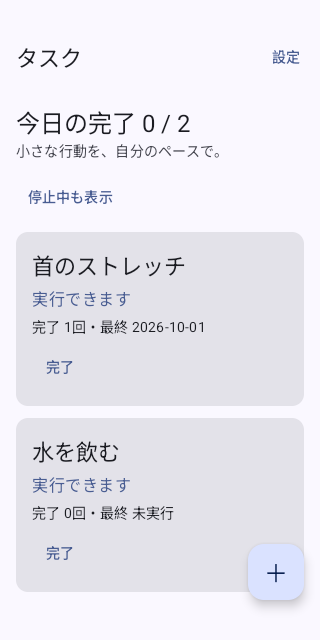
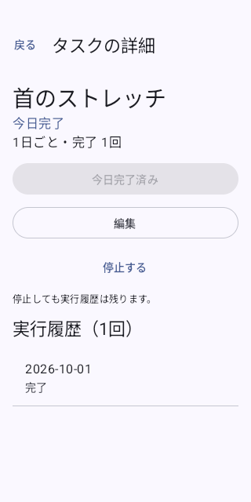
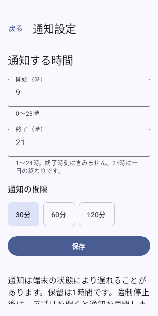

# Task Nudge

忘れがちな小さな行動を、ひとつずつ思い出すための Android アプリです。[元のアイデア](https://github.com/yutotamura55/my-software-ideas/issues/11)をもとにした個人用 MVP です。アカウント、通信、広告、分析機能はありません。

## 使い方

1. 1 件ずつ追加する場合は「＋」からタスク名を入力して保存します。名前だけなら毎日繰り返します。「繰り返しを設定」から 1〜365 日ごと、または 1〜24 時間ごとを選べます。時間ごとのタスクは、最後に完了した時刻から指定時間が過ぎると再び通知の候補になります。
   複数件を追加する場合は一覧上部の「まとめて追加」を開き、1 行に 1 件のタスク名を貼り付けて「まとめて保存」を押します。
   長いタスク名は入力欄を横にスクロールして確認できます。画面幅で折り返されず、入力した改行だけが次のタスクとの区切りになります。
   空行は読み飛ばし、繰り返し日数は全件に共通です。初期値は 1 日で、一度に 100 件まで追加できます。
   名前が 100 文字を超える行など、入力に誤りがある場合は全件を保存せず、画面に理由を表示します。
2. 通知が必要なら、画面の「通知を有効にする」から許可してください。許可しなくても、一覧・詳細・手動完了・履歴は使えます。
3. 通知の「完了」で実行を記録します。同じタスクの通知が複数ある場合は、そのタスクの通知をまとめて消します。「保留」または通知のスワイプ削除では、そのタスクの通知を消し、操作から 24 時間後に再び候補にします。通知をタップするとタスク詳細が開きます。
4. 一覧または詳細の「完了」からも記録できます。日ごとのタスクは同じローカル日付で 1 回、時間ごとのタスクは指定時間が経過するたびに記録できます。過去の未完了分は作りません。

日ごとのタスクは最後の完了日から指定日数が経つと候補になります。時間ごとのタスクは最後の完了時刻から指定時間が経つと候補になります。通知の機会ごとに 1 件ずつ追加し、複数のタスクが候補なら、まだ通知していないタスクから選びます。一巡後は最後の通知が古いタスクから再通知します。未対応の通知は端末の通知欄に残り、最大 40 件まで保持します。上限に達すると古い通知から消えます。初期設定は **09:00 以上 21:00 未満、30 分間隔**。設定画面で時間帯と 15/30/60/120 分間隔を変更できます。通知処理が遅れた場合も、その回に追加するのは 1 件で、過ぎた回数分をまとめて追加しません。

## インストール

対応は **Android 8.0（API 26）以上**です。GitHub Actions の成功した `Android` 実行から `task-nudge-debug` artifact をダウンロードし、ZIP 内の `app-debug.apk` を端末へ転送して開きます。開発用 APK なので、端末で「この提供元からのインストール」を許可する必要があります。APK はストア配布版ではありません。

CI の debug APK は署名を実行間で固定管理していません。同じ署名なら `adb install -r app-debug.apk` で上書きできますが、別の実行で作った APK が上書きできる保証はありません。署名が異なる場合はアンインストールが必要で、端末内の記録も失われます。

Android 13 以上では、明示的に「通知を有効にする」を押したときだけ通知権限を求めます。拒否後は端末のアプリ通知設定から変更できます。Android 8〜12 でも端末全体または通知チャンネルを無効にすると通知されません。

## 通知とデータについて

端末がスリープ中でも通知処理を起こせるよう、OS に次の処理時刻を予約します。予約は目覚まし音や専用画面を出さず、従来の通常通知だけを表示します。WorkManager も予備の確認に使います。省電力設定や端末メーカーの制御により通知は遅れることがあり、15 分間隔を選んでも毎時 4 件は保証されません。アプリを強制停止した後は、手動で開くまで通知処理を再開できません。重要な時刻を知らせる用途には使わないでください。

完了時の端末ローカル日付を履歴に保存します。後でタイムゾーンを変えても保存済みの日付は書き換えません。タスクと履歴は端末内の SQLite にのみ保存し、バックアップと端末移行の対象から除外します。端末メーカーごとのバックアップ挙動には差があります。アンインストールすると記録は失われます。エクスポート、完了取消、全件削除はこの MVP にはありません。

## 画面

[API 35 エミュレーターの CI 実行](https://github.com/yutotamura55/task-nudge/actions/runs/37108961651)で撮影し、原寸で確認した実画面です。一覧では各タスクの状態と累計完了回数を短い行で確認でき、行を開くと最終完了日を含む履歴を見られます。

| タスク一覧 | 完了履歴 | 通知設定 |
| --- | --- | --- |
|  |  |  |

## 開発と検証

JDK 17、Android SDK 36、Gradle 8.13（同梱 wrapper）、AGP 8.13.2、Kotlin 2.2.21 を使います。`scripts/check.sh` は core/app 単体テスト、lint、debug APK と instrumentation APK のビルドを実行します。**専用テスト端末またはエミュレーター**を 1 台接続して `scripts/device-smoke.sh` を実行すると、Compose と実通知の instrumentation テストを実行します。端末テスト後はアプリがアンインストールされるため、普段の記録がある端末では実行しないでください。手順と端末上の確認項目は [docs/testing.md](docs/testing.md)、今回の開発記録は [docs/android-development-notes.md](docs/android-development-notes.md) を参照してください。
